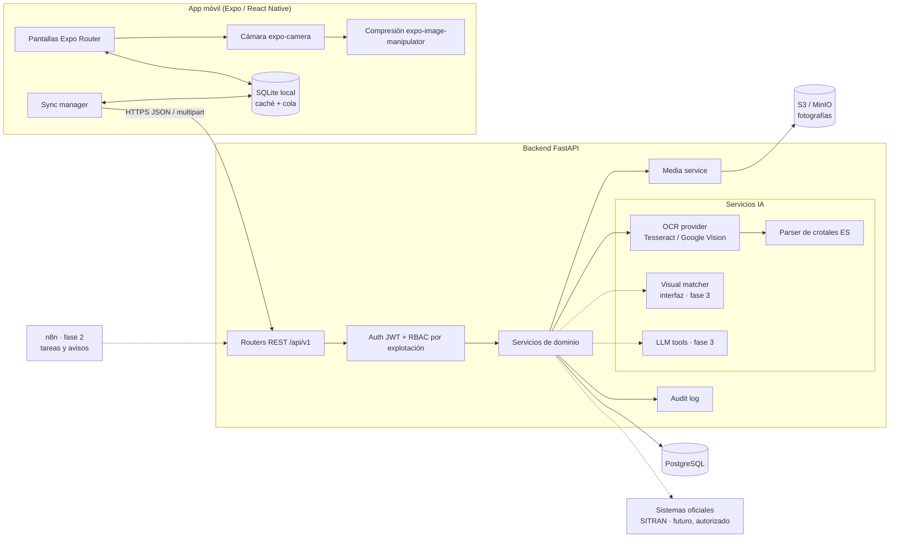
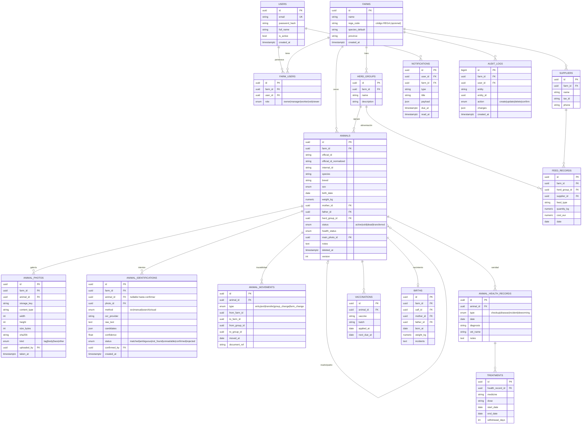
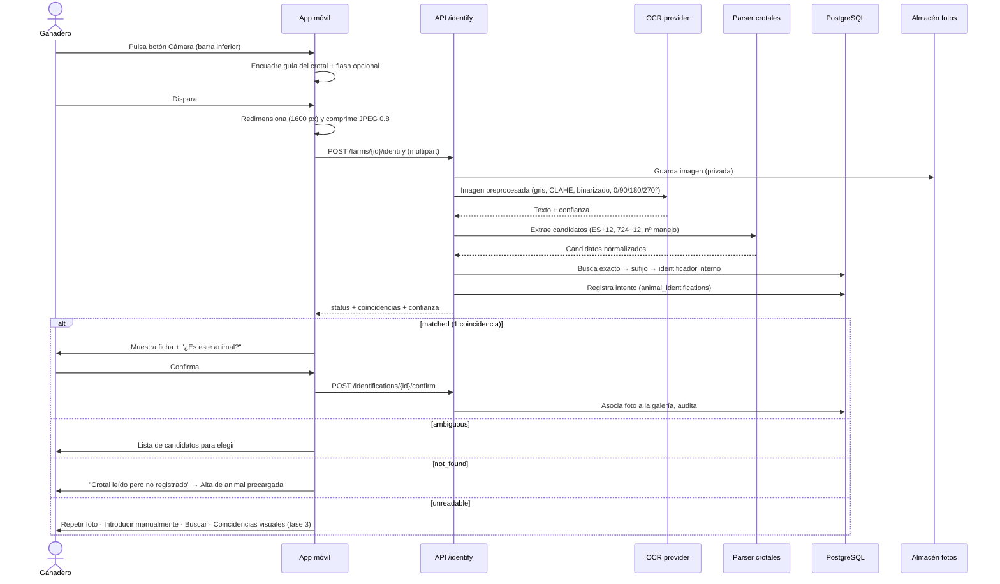

# Ganadería AI — Documento de arquitectura técnica

Versión 0.1 · Fase 1 (MVP) · Noviembre 2026

> Ganadería AI es una herramienta de gestión interna de la explotación. **No sustituye** a los sistemas oficiales de identificación y trazabilidad (SITRAN, REGA, RIIA, libro de explotación oficial). Cualquier integración con ellos se hará solo mediante interfaces y permisos legalmente autorizados (ver §8).

---

## 1. Arquitectura propuesta

Arquitectura cliente-servidor **offline-first**, con un backend modular ("monolito modular") que separa claramente dominios. Se elige monolito modular frente a microservicios porque para una explotación pequeña/mediana y un equipo reducido minimiza coste operativo, y los módulos están desacoplados por interfaces para extraerse a servicios cuando la carga lo justifique (el primer candidato es el procesamiento de imágenes/IA).

Capas:

| Capa | Responsabilidad | Ubicación |
|---|---|---|
| App móvil | UI, cámara, caché local SQLite, cola offline | `mobile/` |
| API | HTTP/REST, auth, validación de entrada (Pydantic) | `backend/app/api/` |
| Lógica de negocio | Reglas de dominio (animales, explotaciones, permisos) | `backend/app/services/` |
| Servicios de IA | OCR, parser de crotales, (futuro) embeddings visuales, LLM | `backend/app/ai/` |
| Procesamiento multimedia | Normalización, compresión, miniaturas, almacenamiento | `backend/app/media/` |
| Persistencia | Modelos SQLAlchemy, migraciones Alembic | `backend/app/models/`, `backend/alembic/` |
| Infraestructura | PostgreSQL, almacenamiento S3 (MinIO), n8n (fase 2) | `docker-compose.yml` |

Principios:

- **Multi-tenant por explotación**: toda entidad de negocio cuelga de `farm_id`; el acceso se valida por pertenencia (`farm_users`) y rol en cada petición.
- **Proveedores intercambiables**: OCR, almacenamiento, reconocimiento visual y LLM se definen como interfaces (`Protocol`) con implementaciones seleccionables por configuración. Si un proveedor externo no está configurado, la capacidad se declara como no disponible en lugar de simularse.
- **Humano en el bucle**: la IA propone, el usuario confirma. Ningún resultado de OCR o visión modifica datos sin confirmación explícita.
- **Auditoría**: toda escritura genera un registro en `audit_logs`.

## 2. Diagrama de componentes

## 3. Modelo de datos

### 3.1 Diagrama entidad-relación

Las entidades marcadas *(F1)* están implementadas y migradas en la Fase 1. El resto está diseñado y se migrará en su fase.

### 3.2 Restricciones e índices clave (F1)

- `animals`: `UNIQUE (farm_id, official_id_normalized) WHERE deleted_at IS NULL` y `UNIQUE (farm_id, internal_id) WHERE deleted_at IS NULL AND internal_id IS NOT NULL` (índices parciales). El identificador oficial es único **por explotación**; un mismo crotal puede existir en dos explotaciones (p. ej. tras una venta) sin colisión, y la trazabilidad se conserva en `animal_movements`.
- Índice `ix_animals_official_suffix` sobre `right(official_id_normalized, 4)` para búsqueda por **número de manejo** (los 4 últimos dígitos, impresos en grande en el crotal).
- `CHECK (mother_id <> id)`, `CHECK (father_id <> id)`, `CHECK (weight_kg > 0)`.
- Borrado lógico (`deleted_at`) para animales: la baja nunca destruye historial.
- Bloqueo optimista con `version` para resolver conflictos de sincronización offline.
- `farm_users (farm_id, user_id)` único.

### 3.3 Formato de crotales españoles (parser)

El parser (`backend/app/ai/tag_parser.py`, replicado en `mobile/src/lib/tagParser.ts`) reconoce:

- **Código oficial**: `ES` + 12 dígitos (bovino, ovino, caprino). Tolera espacios, guiones y confusiones OCR habituales (`O→0`, `I/l→1`, `S→5`, `B→8`, `Z→2`) **solo en la parte numérica**.
- **Identificador electrónico ISO 11784**: `724` (código numérico de España) + 12 dígitos, que se normaliza a `ES` + 12 dígitos.
- **Número de manejo**: 4–6 dígitos aislados, usados para buscar por sufijo cuando el código completo no es legible.

> Verificar la longitud y estructura vigente para cada especie con la normativa autonómica antes de producción. El parser es configurable y cubierto por tests.

## 4. Flujo de identificación mediante cámara

Sin conexión: la app no puede ejecutar OCR en servidor, así que ofrece entrada manual y búsqueda sobre la caché local de SQLite, y conserva la foto en cola para subirla al recuperar cobertura.

### Reconocimiento visual (Fase 3, experimental)

Se define la interfaz `VisualMatcher` (`backend/app/ai/visual.py`). Hoy la implementación por defecto es `DisabledVisualMatcher`, que declara `available = False`; la app muestra la opción como "no disponible todavía". Plan de validación progresiva:

1. Recoger fotos etiquetadas por humanos (ya ocurre en F1: cada confirmación añade una foto verificada a la galería).
2. Generar embeddings (p. ej. DINOv2/CLIP o modelo propio de re-identificación) en `pgvector`.
3. Medir top-1/top-5 por raza, luz y ángulo sobre un conjunto de validación de la propia explotación.
4. Activar la sugerencia solo por encima de un umbral de precisión medido, siempre con confirmación humana y porcentaje de confianza visible.

## 5. Stack tecnológico definitivo

| Ámbito | Elección | Motivo |
|---|---|---|
| Móvil | Expo SDK 58, React Native 0.88, TypeScript estricto | iOS y Android con un código; pruebas inmediatas en Expo Go |
| Navegación | Expo Router (tabs + stack) | Rutas por archivos, deep links |
| Cámara | expo-camera (`CameraView`) + expo-image-picker (galería) | Incluidos en Expo Go; galería permite probar con fotos reales ya hechas |
| Imagen | expo-image-manipulator | Reducir peso antes de subir con mala cobertura |
| Local | expo-sqlite, expo-secure-store | Caché offline y tokens cifrados en llavero/Keystore |
| Estado servidor | TanStack Query | Caché, reintentos, invalidación |
| Backend | Python 3.12+, FastAPI, SQLAlchemy 2, Alembic, Pydantic v2 | Tipado, rendimiento, ecosistema IA |
| BD | PostgreSQL 16 (+ pgvector en fase 3) | Integridad relacional, índices parciales, vectores |
| Fotos | S3 compatible (MinIO en local; AWS S3/Scaleway/OVH en producción, región UE) | RGPD: datos en la UE |
| OCR | Tesseract 5 (por defecto, autoalojado) · Google Cloud Vision (opcional, por config) | Coste cero de partida; proveedor cloud para mayor precisión |
| Auth | JWT de acceso (15 min) + refresh (30 días), bcrypt | Estándar, sin dependencias externas |
| Contenedores | Docker + Docker Compose | Despliegue reproducible |
| Automatización | n8n (fase 2) | Recordatorios de vacunas y vencimientos |
| LLM | API de LLM con *tool use* (fase 3) | Asistente con herramientas estructuradas, sin inventar datos |

## 6. Plan de desarrollo por fases

| Fase | Alcance | Criterio de salida |
|---|---|---|
| **1 · MVP** (este entregable) | Registro/login, explotaciones y roles, CRUD de animales con baja lógica, lotes, fichas con galería, cámara y galería del móvil, OCR de crotales, búsqueda por identificador y nº de manejo, dashboard básico, import/export CSV y Excel, auditoría, caché offline de consulta | Identificar un animal real fotografiando su crotal en iPhone y Android |
| **2 · Gestión avanzada** | Sanidad, vacunas, tratamientos (con plazos de supresión), nacimientos (alta automática del ternero), movimientos y trazabilidad, alimentación y costes, calendario, notificaciones push vía n8n, cola de escritura offline con resolución de conflictos | Ciclo completo de una temporada registrado en la app |
| **3 · IA** | Asistente con herramientas (consultas y escrituras con confirmación), registro por voz (transcripción → extracción → vista previa → confirmación), reconocimiento visual experimental con métricas | Precisión medida y documentada; 0 escrituras sin confirmación |
| **4 · Comercialización** | Suscripciones y planes, panel de administración, métricas de uso, multiempresa con varias explotaciones por cuenta, escalado horizontal, copias de seguridad gestionadas | Primeros clientes de pago |

## 7. Seguridad y RGPD

- HTTPS obligatorio en producción (terminación TLS en el proxy inverso; ver `DEPLOY.md`).
- Contraseñas con bcrypt; tokens en almacenamiento seguro del sistema (Keychain / Keystore).
- Autorización por explotación en cada endpoint; roles `owner`, `manager`, `worker`, `vet`, `viewer`.
- Fotos privadas: nunca públicas en el bucket; se sirven a través de la API con autenticación.
- Cifrado en reposo: cifrado de servidor del bucket (SSE) y del volumen de PostgreSQL en el proveedor.
- Auditoría de todas las modificaciones.
- Copias de seguridad: `pg_dump` diario + versionado del bucket (script en `DEPLOY.md`).
- RGPD: datos alojados en la UE, exportación de datos de la explotación (CSV/Excel), borrado de cuenta bajo petición (fase 4 automatizado), registro de actividades de tratamiento a cargo del titular del SaaS.

## 8. Integraciones futuras con sistemas oficiales

El módulo `backend/app/integrations/official.py` define la interfaz `OfficialRegistryClient` (consultar censo, notificar movimientos). No existe implementación: SITRAN y los sistemas autonómicos requieren alta, credenciales y autorización de la administración competente. Cuando se disponga de ellos se implementará un adaptador por comunidad autónoma sin tocar la lógica de negocio.
